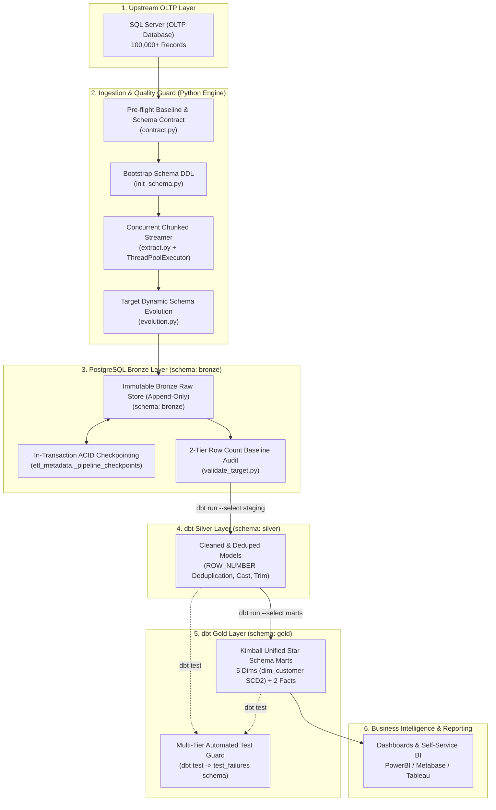

# Olist E-Commerce Enterprise Medallion Data Pipeline

[](https://www.python.org/)
[](https://www.postgresql.org/)
[](https://www.getdbt.com/)
[](https://www.docker.com/)
[](https://www.microsoft.com/sql-server)
[](.github/workflows/ci.yml)

Hệ thống Data Engineering chuẩn doanh nghiệp theo mô hình **Medallion Architecture (Bronze -> Silver -> Gold)**, trích xuất dữ liệu giao dịch thương mại điện tử từ Microsoft SQL Server (OLTP), nạp trực tiếp vào PostgreSQL Data Warehouse theo cơ chế **Bronze Append-Only**, khử trùng lặp và làm sạch tại tầng **Silver**, sau đó mô hình hóa thành **Kimball Star Schema** tại tầng **Gold** bằng dbt Core.

---

## 1. Tổng quan Kiến trúc Pipeline (Architecture Overview)

Dự án áp dụng kiến trúc **Medallion (Lakehouse-style)** nhằm giải quyết dứt điểm các hạn chế của quy trình ETL truyền thống:

### Các tính năng cốt lõi (Key Features):
* **Bronze Append-Only Ingestion**: Nạp dữ liệu thô nguyên bản $100\%$ từ SQL Server vào PostgreSQL `bronze` mà không lọc bỏ dòng hay đè dữ liệu. Không mắc "Nghịch lý Incremental" (loại bỏ hoàn toàn việc copy 1 triệu dòng cũ sang staging), chỉ nạp đúng phần delta phát sinh ($O(\Delta N)$).
* **In-Transaction Atomic Checkpoint & Watermark**: Mỗi chunk nạp vào và mốc checkpoint trong `etl_metadata._pipeline_checkpoints` được thực thi trong **cùng 1 Transaction ACID**. Khi có sự cố, chunk lỗi tự động rollback, các chunk đã commit trước đó được bảo toàn, cho phép resume chính xác ở lần chạy sau.
* **Data Versioning & Audit Trail**: Lưu trữ toàn bộ lịch sử biến động trạng thái đơn hàng (ví dụ: `created` -> `shipped` -> `delivered`) với siêu dữ liệu `_batch_id` và `_extracted_at`, phục vụ truy vết kiểm toán và phân tích chuỗi sự kiện.
* **Khử trùng lặp tại tầng Silver dbt (SQL-based Deduplication)**: Chuyển toàn bộ tải tính toán làm sạch, ép kiểu và khử trùng lặp về tầng Silver qua `ROW_NUMBER() OVER (PARTITION BY pk ORDER BY _extracted_at DESC)`. Đảm bảo tính **Idempotency tuyệt đối**.
* **Unified Gold Star Schema (Kimball)**: Hợp nhất toàn bộ 5 bảng Dimension (bao gồm SCD Type 2 theo dõi khách hàng chuyển địa điểm) và 2 bảng Fact vào một schema duy nhất (`gold`).
* **Trích xuất đồng thời (Concurrent Extraction)**: Hỗ trợ `ThreadPoolExecutor` nạp song song nhiều bảng, kết hợp cơ chế thử lại (exponential backoff retry) khi kết nối mạng chập chờn.
* **Unified Logging UTC**: Đồng bộ hóa toàn bộ luồng log giữa Python EL và dbt CLI theo chuẩn giờ UTC (`%Y-%m-%d %H:%M:%S UTC`) được lưu trữ tại `logs/pipeline.log`.
* **Khung kiểm thử chất lượng 4 tầng (4-Tier Quality Framework)**: Phủ kín từ kiểm tra độ tươi mới (freshness) tầng nguồn, hợp lệ tầng Silver, toàn vẹn khóa tầng Marts đến đối chiếu doanh thu, số lượng đơn hàng tầng Gold.

---

## 2. Mô tả Luồng Xử lý Dữ liệu Hiện tại (Current Data Flow)



### Các bước vận hành chi tiết:
1. **Kiểm tra kết nối & Tiền điều kiện (Pre-flight Checks)**: Xác thực cổng mạng, kiểm tra quyền truy cập SQL Server (ODBC Driver 18) và PostgreSQL 16.
2. **Khởi tạo & Đồng bộ Cấu trúc (Schema Initialization & Evolution)**:
   * Chạy [init_bronze_schema](file:///d:/code/personal_project/etl_ecommerce_data/src/schema/init_schema.py) tạo bảng `CREATE TABLE IF NOT EXISTS` trong schema `bronze`.
   * Tự động phát hiện và thêm cột mới (`ALTER TABLE ADD COLUMN`) vào Bronze nếu schema nguồn có cập nhật.
3. **Đọc Checkpoint & Xác định dải Watermark**:
   * Kiểm tra bảng `etl_metadata._pipeline_checkpoints` và `bronze._etl_watermarks` để xác định mốc dữ liệu đã commit gần nhất.
4. **Đo lường Baseline Nguồn (Source Baseline Probe)**:
   * Kiểm đếm số dòng thực tế từ SQL Server dưới mức cô lập `READ COMMITTED`.
5. **Trích xuất & Nạp dòng song song (Concurrent Extract & Load)**:
   * Phân luồng `ThreadPoolExecutor` xử lý đồng thời nhiều bảng.
   * Nạp trực tiếp từng chunk vào bảng `bronze` qua PostgreSQL COPY Protocol siêu tốc.
   * Commit dữ liệu chunk và mốc checkpoint trong **cùng 1 Transaction ACID**.
6. **Kiểm toán số dòng 2 tầng (2-Tier Baseline Audit)**:
   * Đối chiếu số dòng đã nạp với baseline để phát hiện thất thoát dữ liệu ngay tại đích đến.
7. **Biến đổi & Khử trùng lặp tại tầng Silver dbt**:
   * Lọc bản ghi hợp lệ, ép kiểu, chuẩn hóa chuỗi và chọn bản ghi mới nhất qua `ROW_NUMBER() OVER (PARTITION BY pk ORDER BY _extracted_at DESC)`.
8. **Mô hình hóa Star Schema tại tầng Gold & Chạy bộ Test 4 tầng**:
   * Xây dựng Dimension (SCD Type 2 cho khách hàng) và Fact tables.
   * Chạy bộ test tự động đối chiếu doanh thu, số lượng đơn và lưu các dòng vi phạm vào schema `test_failures`.

---

## 3. Cấu trúc Thư mục Dự án (Project Directory Structure)

```text
etl_ecommerce_data/
├── .env                              # Thông tin cấu hình môi trường & kết nối CSDL
├── .env.example                      # Template mẫu cho cấu hình môi trường
├── .gitattributes                    # Chuẩn hóa ký tự xuống dòng LF
├── .gitignore                        # Danh sách loại trừ khỏi git (venv, logs, credentials)
├── requirements.txt                  # Danh mục thư viện Python
├── run.sh                            # Script CLI điều phối pipeline tổng hợp (Linux/macOS/Git Bash)
├── main.py                           # File thực thi điều phối trung tâm (Bronze EL + dbt)
│
├── logs/
│   └── pipeline.log                  # File log duy nhất của pipeline (ghi giờ chuẩn UTC, xoay vòng 10MB)
│
├── Docker/
│   ├── Dockerfile                    # Container Debian 12 + Python 3.11 + Microsoft ODBC Driver 18
│   └── docker-compose.yml            # Điều phối multi-container (DWH PostgreSQL + ETL App)
│
├── docs/
│   ├── README.md                     # Tài liệu kỹ thuật chi tiết của dự án
│   ├── olap_olist.drawio             # Sơ đồ kiến trúc Star Schema (OLAP)
│   └── oltp_olist.drawio             # Sơ đồ cơ sở dữ liệu giao dịch nguồn (OLTP)
│
├── sql/
│   ├── source/                       # DDL và dữ liệu kiểm thử trên SQL Server
│   │   ├── create_table.sql          # DDL bảng nguồn có ràng buộc
│   │   ├── insert_data.sql           # Script nạp dữ liệu mẫu
│   │   └── validate_source.sql       # Truy vấn kiểm tra sức khỏe nguồn
│   └── raw/                          # DDL tầng Bronze trên PostgreSQL
│       ├── raw_table.sql             # DDL bảng thô Bronze (Composite Index, Audit columns)
│       └── validate_staging.sql      # Truy vấn kiểm tra tầng Bronze
│
├── src/                              # Bộ máy trích xuất & nạp dữ liệu (Python Engine)
│   ├── config/
│   │   ├── config.py                 # Nạp biến môi trường, cấu hình engine SQLAlchemy
│   │   └── extract_rules.yaml        # Quy tắc trích xuất từng bảng (watermark, full, chunk_size)
│   ├── schema/
│   │   ├── __init__.py               # Điểm xuất khẩu các module schema
│   │   ├── contract.py               # Kiểm tra hợp đồng cấu trúc cột và khóa chính trước khi nạp
│   │   ├── evolution.py              # Tự động đồng bộ hóa cột mới phát sinh vào Bronze
│   │   └── init_schema.py            # Khởi tạo DDL bảng Bronze (Append-Only mode)
│   ├── validate/
│   │   ├── validate_source.py        # Đo lường số dòng và schema baseline của nguồn
│   │   ├── validate_target.py        # Kiểm toán số dòng Bronze đối chiếu với baseline nguồn
│   │   └── validate_pipeline.py      # Đảm bảo toàn bộ bảng bắt buộc được nạp thành công
│   ├── checkpoint.py                 # Quản lý mốc watermark (_etl_watermarks) & lịch sử chạy
│   ├── checkpoint_manager.py         # Quản lý checkpoint atomic theo từng chunk trong transaction
│   ├── database.py                   # Quản trị kết nối DB và hàm retry có exponential backoff
│   ├── extract.py                    # Generator stream từng chunk từ SQL Server theo dải watermark
│   ├── load.py                       # Nạp chunk vào Bronze và ghi checkpoint nguyên tử trong 1 transaction
│   ├── logger.py                     # Cấu hình log chuẩn UTC (Console & Rotating File Handler)
│   └── dbt_runner.py                 # Điều phối chạy dbt CLI và đồng bộ log dbt vào pipeline.log
│
├── tests/                            # Bộ kiểm thử đơn vị Python (Unit Test Suite)
│   └── test_unit_pipeline.py         # Test Schema Contract, Dynamic Query Builders, Checkpoint logic
│
└── dbt_transform/                    # Dự án dbt Core mô hình hóa dữ liệu (Silver & Gold)
    ├── dbt_project.yml               # Cấu hình dự án dbt, chỉ định schema silver và gold
    ├── profiles.yml                  # Cấu hình kết nối dbt tới PostgreSQL
    ├── macros/
    │   ├── generate_schema_name.sql  # Macro tùy biến giữ nguyên tên schema riêng biệt (silver, gold)
    │   └── unique_combination.sql    # Macro kiểm tra tính duy nhất của khóa tổ hợp
    ├── models/
    │   ├── staging/                  # ── [TẦNG SILVER: DEDUP & CLEANING] ──────────
    │   │   ├── sources.yml           # Khai báo source Bronze, kiểm tra freshness, null & unique
    │   │   ├── schema.yml            # Data tests & tài liệu các trường bảng Silver
    │   │   └── stg_*.sql             # 7 model làm sạch và lọc bản ghi mới nhất qua ROW_NUMBER()
    │   └── marts/                    # ── [TẦNG GOLD: UNIFIED STAR SCHEMA] ─────────
    │       ├── schema.yml            # Cấu hình quan hệ khóa ngoại (FK), index và tests tầng Marts
    │       ├── dim_*.sql             # 5 Dimensions (dim_customer SCD Type 2, dim_product, dim_date...)
    │       └── fact_*.sql            # 2 Fact tables (fact_orders, fact_sales)
    └── tests/                        # Bộ kiểm thử quy tắc nghiệp vụ tầng Gold (Singular Tests)
        ├── assert_delivered_orders_have_delivery_date.sql
        ├── assert_fact_orders_match_sales_amount.sql
        ├── assert_fact_orders_match_sales_items_count.sql
        ├── assert_order_dates_chronology.sql
        ├── assert_sales_amounts_positive.sql
        └── assert_valid_review_score.sql
```

---

## 4. Hướng dẫn Triển khai (Deployment Guide)

### 4.1. Yêu cầu Hệ thống (Prerequisites)
* **Python**: Phiên bản 3.11 trở lên
* **PostgreSQL**: Phiên bản 15 hoặc 16
* **Microsoft SQL Server**: 2017, 2019, 2022 hoặc SQL Server Express
* **ODBC Driver**: Microsoft ODBC Driver 18 for SQL Server (hoặc Driver 17)
* **Docker & Docker Compose**: (Tùy chọn khi chạy containerized)

### 4.2. Cài đặt Môi trường (Environment Setup)

1. **Clone repository và di chuyển vào thư mục:**
   ```bash
   git clone https://github.com/your-username/etl_ecommerce_data.git
   cd etl_ecommerce_data
   ```

2. **Khởi tạo và kích hoạt môi trường ảo Python:**
   * Trên Windows (PowerShell):
     ```powershell
     python -m venv .venv
     .\.venv\Scripts\Activate.ps1
     ```
   * Trên Linux / macOS:
     ```bash
     python3 -m venv .venv
     source .venv/bin/activate
     ```

3. **Cài đặt các thư viện phụ thuộc:**
   ```bash
   pip install --upgrade pip
   pip install -r requirements.txt
   ```

4. **Thiết lập biến môi trường:**
   Tạo file `.env` từ file mẫu `.env.example`:
   ```bash
   cp .env.example .env
   ```
   Cấu hình thông số kết nối:
   ```ini
   # Cấu hình log
   LOG_LEVEL_CONSOLE=INFO
   LOG_LEVEL_FILE=DEBUG

   # Cấu hình nguồn SQL Server (OLTP)
   SRC_DB_DRIVER=ODBC Driver 18 for SQL Server
   SRC_DB_SERVER=localhost
   SRC_DB_PORT=1433
   SRC_DB_NAME=olist
   SRC_DB_USER=sa
   SRC_DB_PASSWORD=YourStrongPassword123!
   SRC_DB_TRUSTED_CONNECTION=no
   SRC_DB_TRUST_SERVER_CERTIFICATE=yes

   # Cấu hình đích PostgreSQL Data Warehouse
   TGT_DB_HOST=localhost
   TGT_DB_PORT=5432
   TGT_DB_NAME=olist_dwh
   TGT_DB_USER=postgres
   TGT_DB_PASSWORD=postgres
   TGT_DB_SCHEMA=bronze

   # Cấu hình hiệu năng pipeline
   ETL_MAX_WORKERS=4
   CHUNK_SIZE=25000
   ```

### 4.3. Cách Chạy Pipeline (Execution Options)

#### Lựa chọn 1: Chạy trực tiếp trên Windows PowerShell

```powershell
# 1. Chạy nạp dữ liệu tầng Bronze (Append-Only mode):
.\.venv\Scripts\python.exe main.py

# 2. Chạy toàn bộ luồng End-to-End (Bronze -> Silver -> Gold -> Tests):
.\.venv\Scripts\python.exe main.py --all

# 3. Chạy ở chế độ tuần tự (Sequential mode - dành cho máy cấu hình thấp):
.\.venv\Scripts\python.exe main.py --sequential

# 4. Chạy riêng lẻ các tầng dbt với định dạng log chuẩn hóa:
.\.venv\Scripts\python.exe -m src.dbt_runner silver    # Chỉ chạy tầng Silver
.\.venv\Scripts\python.exe -m src.dbt_runner gold      # Chỉ chạy tầng Gold
.\.venv\Scripts\python.exe -m src.dbt_runner test      # Chạy toàn bộ bài test dbt
```

#### Lựa chọn 2: Sử dụng Unified CLI qua `run.sh` (Linux / macOS / Git Bash)

```bash
chmod +x run.sh

# Chạy trọn vẹn toàn bộ pipeline:
./run.sh pipeline

# Hoặc chạy từng công đoạn riêng biệt:
./run.sh extract-load        # Nạp dữ liệu vào Bronze
./run.sh transform           # Chạy dbt Silver, Gold và Tests
./run.sh transform-silver    # Chỉ chạy dbt Silver
./run.sh transform-gold      # Chỉ chạy dbt Gold
./run.sh test                # Chạy kiểm thử chất lượng dữ liệu
./run.sh clean               # Dọn dẹp cache biên dịch của dbt
```

#### Lựa chọn 3: Triển khai toàn bộ cụm qua Docker Compose

Khởi chạy đồng thời cả cụm 3 container gồm Microsoft SQL Server 2022 (OLTP), PostgreSQL 16 (DWH) và ETL Engine container (đã cấu hình chạy dưới người dùng non-root an toàn):
```bash
docker compose --env-file .env -f Docker/docker-compose.yml up --build
```

---

## 5. Khung Kiểm thử Toàn diện (Testing & Quality Assurance)

Dự án thiết lập hệ thống kiểm định chất lượng dữ liệu đa tầng theo đúng chuẩn Data Observability:

### 5.1. Ma trận Kiểm thử 4 tầng (Multi-Tier Test Matrix)

| Vị trí | Nội dung kiểm tra | Mục đích & Chi tiết triển khai | Nơi cấu hình trong dự án |
| :--- | :--- | :--- | :--- |
| **1. Source / Bronze** | `NULL`, `duplicate`, `schema`, `freshness` | **Kiểm tra dữ liệu đầu vào:**<br>• `freshness`: Cảnh báo nếu dữ liệu không có cập nhật mới sau 24h, báo lỗi sau 48h.<br>• `not_null`, `unique`: Giám sát tính toàn vẹn khóa thô.<br>• `contract.py`: Chặn nạp nếu nguồn bị thiếu cột khóa chính. | [dbt_transform/models/staging/sources.yml](file:///d:/code/personal_project/etl_ecommerce_data/dbt_transform/models/staging/sources.yml)<br>[src/schema/contract.py](file:///d:/code/personal_project/etl_ecommerce_data/src/schema/contract.py) |
| **2. Silver Staging** | `not_null`, `unique`, `accepted_values` | **Kiểm tra dữ liệu sau làm sạch:**<br>• Đảm bảo khóa chính sau khử trùng lặp là duy nhất 100%.<br>• Trạng thái đơn hàng thuộc tập giá trị cho phép (`delivered`, `shipped`, `canceled`...). | [dbt_transform/models/staging/schema.yml](file:///d:/code/personal_project/etl_ecommerce_data/dbt_transform/models/staging/schema.yml) |
| **3. Fact / Dimension** | `PK`, `FK`, `relationships` | **Kiểm tra tính toàn vẹn mô hình:**<br>• Ràng buộc khóa ngoại: 100% bản ghi Fact phải tham chiếu đúng Dimension tồn tại, không có đơn hàng mồ côi.<br>• Kiểm tra tính duy nhất của Surrogate Keys. | [dbt_transform/models/marts/schema.yml](file:///d:/code/personal_project/etl_ecommerce_data/dbt_transform/models/marts/schema.yml) |
| **4. Gold** | `Tổng doanh thu`, `Số lượng`, `Quy tắc nghiệp vụ` | **Đảm bảo dữ liệu phân tích chính xác tuyệt đối:**<br>• Đối chiếu doanh thu: Tổng tiền trên `fact_orders` khớp với tổng các dòng hàng trên `fact_sales`.<br>• Đối chiếu số lượng: Số mặt hàng trên `fact_orders` khớp 100% số dòng hàng thực tế trên `fact_sales`.<br>• Kiểm tra logic ngày: Ngày giao hàng phải sau ngày đặt hàng. | [dbt_transform/tests/](file:///d:/code/personal_project/etl_ecommerce_data/dbt_transform/tests/) |

### 5.2. Chạy Kiểm thử Đơn vị Python (Unit Test Suite)
Kiểm tra tính hợp lệ của hợp đồng Schema, câu truy vấn trích xuất động và cấu hình Checkpoint:
```powershell
.\.venv\Scripts\python.exe -m unittest discover tests
# Ran 7 tests in 0.002s -> OK (100% Passed)
```

### 5.3. Chạy Kiểm thử Chất lượng Dữ liệu dbt
Thực thi toàn bộ các bài test schema và quy tắc nghiệp vụ:
```powershell
.\.venv\Scripts\python.exe -m src.dbt_runner test
# Hoặc qua run.sh:
./run.sh test
```
*Lưu ý: Bất kỳ bản ghi nào vi phạm quy tắc kiểm thử sẽ được dbt tự động ghi nhận vào schema `test_failures` trên PostgreSQL để kỹ sư dữ liệu dễ dàng truy vết nguyên nhân gốc rễ (Root Cause Analysis).*

---

## 6. Truy vấn Mẫu Phân tích Dữ liệu tầng Gold (Sample Analytics Queries)

### 6.1. Doanh thu theo tháng & Đánh giá mức độ hài lòng khách hàng
```sql
SELECT
    d.year,
    d.month,
    d.month_name,
    COUNT(DISTINCT fo.order_key) AS total_orders,
    SUM(fo.total_order_amount) AS gross_revenue,
    ROUND(AVG(fo.review_score), 2) AS avg_satisfaction_score
FROM gold.fact_orders fo
INNER JOIN gold.dim_date d ON fo.purchase_date_key = d.date_key
WHERE fo.order_status = 'delivered'
GROUP BY d.year, d.month, d.month_name
ORDER BY d.year, d.month;
```

### 6.2. Phân tích lịch sử thay đổi địa điểm khách hàng (SCD Type 2)
```sql
SELECT
    dc.customer_unique_id,
    dl.city_name,
    dl.state_code,
    dc.valid_from,
    dc.valid_to,
    dc.is_current
FROM gold.dim_customer dc
INNER JOIN gold.dim_location dl ON dc.location_key = dl.location_key
WHERE dc.customer_unique_id IN (
    SELECT customer_unique_id
    FROM gold.dim_customer
    GROUP BY customer_unique_id
    HAVING COUNT(*) > 1
)
ORDER BY dc.customer_unique_id, dc.valid_from;
```

---

## 7. Giấy phép & Tác giả (License & Author)
* **Dự án**: Olist E-Commerce Medallion Data Engineering Pipeline
* **Bộ dữ liệu**: Brazilian E-Commerce Public Dataset by [Olist](https://www.kaggle.com/datasets/olistbr/brazilian-ecommerce)
* **Giấy phép**: MIT License.
