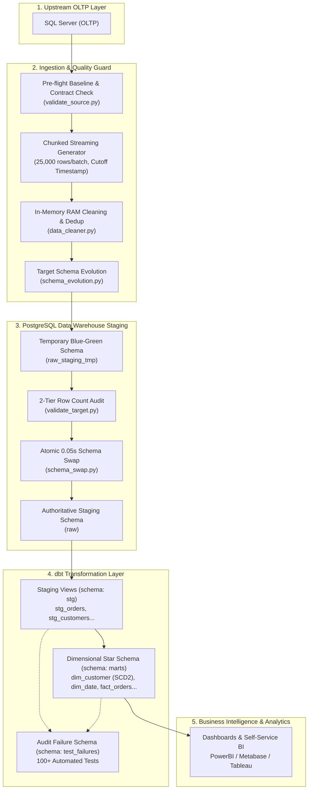
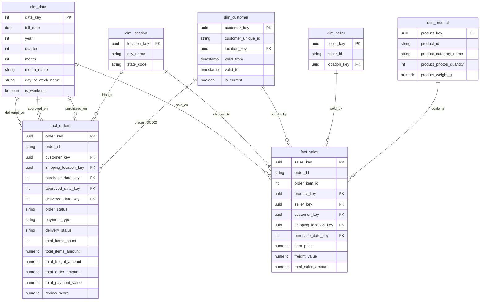

# Olist E-Commerce Enterprise ELT Data Pipeline

[](https://www.python.org/)
[](https://www.postgresql.org/)
[](https://www.getdbt.com/)
[](https://www.docker.com/)
[](https://www.microsoft.com/sql-server)

An enterprise-grade, end-to-end, production-ready ELT (Extract - Load - Transform) pipeline designed to ingest, validate, audit, and model over 100,000 real-world commercial transactions from Microsoft SQL Server (OLTP) into a PostgreSQL Data Warehouse, transformed into Kimball-standard Star Schema Data Marts using dbt Core.

---

## 1. Project Overview

This project delivers a resilient, fault-tolerant Data Engineering pipeline that bridges transactional operations and enterprise business intelligence. 

### Key Highlights:
- **Zero-Downtime Atomic Swaps**: Blue-Green schema swapping (`raw_staging_tmp` -> `raw`) ensures downstream BI dashboards never query incomplete or empty staging tables during ingestion.
- **Idempotent Ingestion & Checkpointing**: Chunk-based streaming (25,000 rows/batch) with transactional temporary staging and Primary Key UPSERT guarantees 100% duplicate-free data, even after mid-pipeline crashes.
- **Strict Data Contracts & Schema Evolution**: Pre-flight validation safeguards against upstream column deletion or renaming, while automated schema evolution handles upstream column additions on the fly without breaking pipelines.
- **Kimball Dimensional Modeling**: Modeled into a Star Schema comprising 2 Fact tables and 5 Dimensions, including Slowly Changing Dimensions (SCD Type 2) for historical customer tracking and deterministic array aggregation for order payment analysis.
- **Comprehensive Quality Assurance**: Over 100 automated data tests in dbt alongside a 2-tier pre/post-load baseline audit, storing any test failure records directly into a dedicated database audit schema (`test_failures`).

---

## 2. Business Problem

Olist operates the largest department store marketplace in Brazilian e-commerce, connecting thousands of merchants with millions of customers. The operational OLTP system (running on Microsoft SQL Server) was experiencing significant challenges:

1. **Transactional Database Contention**: Analytical queries run directly by marketing, finance, and logistics teams caused severe lock contention and CPU spikes on production transactional databases.
2. **Data Integrity Hazards & Out-of-Order Events**: Real-world operations suffered from out-of-order order confirmations, review updates arriving days after delivery, and multiple payment methods per order.
3. **Customer Relocation Tracking (Data Drift)**: Customers moved cities between orders. Without SCD Type 2 tracking, analytical aggregations credited historical revenues to current addresses, producing skewed regional logistics insights.
4. **Pipeline Vulnerability**: Frequent upstream database changes (adding marketing tags, altering columns) regularly caused traditional ETL scripts to crash, resulting in hours of stale data and missing metrics.

---

## 3. Project Objectives

- [x] **Decouple Analytics from OLTP**: Offload analytical workloads completely into an optimized PostgreSQL Data Warehouse.
- [x] **Eliminate Ingestion Downtime**: Achieve 0.05-second atomic schema swaps so end-users never experience empty staging tables during refreshes.
- [x] **Guarantee Idempotency & Fault Tolerance**: Enable arbitrary pipeline restarts with per-chunk checkpointing and watermark persistence, avoiding full re-extracts.
- [x] **Implement Enterprise Dimensional Models**: Build high-performance Fact and Dimension tables aligned with business KPIs: Gross Merchandise Value (GMV), Freight Ratios, Delivery Timeliness, and Customer Lifetime Value (CLV).
- [x] **Automate 100% Data Testing**: Deploy automated constraints, referential integrity tests, domain accepted values, and revenue balance cross-table tests.
- [x] **Full Infrastructure Containerization**: Package the entire pipeline into reproducible Docker containers with Microsoft ODBC Driver 18 and automated bash runners.

---

## 4. Tech Stack

| Category | Technology | Version | Purpose |
|---|---|---|---|
| **Programming Language** | Python | 3.11+ | Pipeline orchestration, data validation, streaming extraction |
| **Database Connectors** | SQLAlchemy, pyodbc | 2.0+ / 5.0+ | Database engine abstraction and connection pooling |
| **ODBC Driver** | Microsoft ODBC Driver | 18 for SQL Server | High-performance enterprise connectivity to SQL Server |
| **Data Processing** | pandas | 2.2+ | In-memory batch chunking, fast hashing, RAM deduplication |
| **Source Database (OLTP)** | Microsoft SQL Server | 2019/2022 | Production transactional relational database |
| **Target Database (DWH)** | PostgreSQL | 16 | Relational staging layer and dimensional data warehouse |
| **Transformation & Modeling** | dbt Core (dbt-postgres) | 1.12.6 / 1.11.0 | ELT SQL transformations, lineage DAG, data quality tests |
| **Containerization** | Docker & Docker Compose | Latest | Reproducible environments, cross-platform deployment |
| **Operating System Support** | Windows 11 & Linux/macOS | - | Cross-platform execution with strict LF `.gitattributes` |

---

## 5. Data Sources

The source dataset is the renowned **Brazilian E-Commerce Public Dataset by Olist** (~100,000 orders spanning 2016 to 2018):

```
       +-----------------------+       +-------------------------+
       |   olist_customers     |       |    olist_sellers        |
       |-----------------------|       |-------------------------|
       | PK customer_id        |       | PK seller_id            |
       |    customer_unique_id |       |    seller_zip_code      |
       |    customer_city/state|       |    seller_city/state    |
       +-----------+-----------+       +------------+------------+
                   | 1                              | 1
                   |                                |
                   | N                              | N
       +-----------v-----------+       +------------v------------+
       |     olist_orders      | 1   N |    olist_order_items    |
       |-----------------------+-------+-------------------------|
       | PK order_id           |       | PK,FK order_id          |
       | FK customer_id        |       | PK    order_item_id     |
       |    order_status       |       | FK    product_id        |
       |    order_purchase_ts  |       | FK    seller_id         |
       |    order_approved_at  |       |       price, freight    |
       +-----------+-----------+       +------------+------------+
                   | 1                              | N
         +---------+---------+                      |
       1 | N               1 | N                    | 1
+--------v--------+ +--------v--------+    +--------v--------+
|  order_payments | |  order_reviews  |    |  olist_products |
|-----------------| |-----------------|    |-----------------|
| PK order_id     | | PK,FK order_id  |    | PK product_id   |
| PK payment_seq  | | PK    review_id |    |    category_name|
|    payment_type | |       score     |    |    weight, dim  |
+-----------------+ +-----------------+    +-----------------+
```

| Source Table Name | Approximate Rows | Grain / Primary Key | Description |
|---|---|---|---|
| `olist_customers_dataset` | 99,441 | `customer_id` | Customer checkout transactions and geographic locations |
| `olist_orders_dataset` | 99,441 | `order_id` | Core lifecycle timestamps (purchase, approve, deliver) |
| `olist_order_items_dataset` | 112,650 | `(order_id, order_item_id)` | Line items detailing product, seller, price, and shipping freight |
| `olist_order_payments_dataset` | 103,886 | `(order_id, payment_sequential)` | Payment methods (credit card, voucher, boleto), installments, value |
| `olist_order_reviews_dataset` | 99,224 | `(review_id, order_id)` | Customer feedback, 1-5 star ratings, and review response timestamps |
| `olist_products_dataset` | 32,951 | `product_id` | Product catalog metadata, categories, dimensions, and weights |
| `olist_sellers_dataset` | 3,095 | `seller_id` | Merchant locations, zip codes, and regional registration |

---

## 6. Data Pipeline Architecture



---

## 7. Data Processing Workflow

The entire lifecycle executes end-to-end via `main.py` through 8 robust, decoupled steps:

```
[Start]
   │
   ▼
1. Connection Verification  ──► Verify credentials for SQL Server (ODBC 18) and PostgreSQL.
   │
   ▼
2. Checkpoint Discovery    ──► Read latest watermark timestamps from `_etl_watermarks`.
   │
   ▼
3. Blue-Green Staging Prep ──► Recreate `raw_staging_tmp`, copy watermark states & base incremental tables.
   │
   ▼
4. Source Baseline Probe   ──► Measure exact row counts from SQL Server under `READ COMMITTED`.
   │
   ▼
5. Stream Extract & Clean  ──► Stream chunks (25k rows), filter NULL PKs, deduplicate on RAM.
   │
   ▼
6. Idempotent UPSERT       ──► Load into temp table, `DELETE ... USING` + `INSERT`, commit checkpoint.
   │
   ▼
7. 2-Tier Baseline Audit   ──► Verify `stg_rows >= expected` and `loaded_rows == stg_rows`.
   │
   ▼
8. Atomic Schema Swap      ──► Swap `raw_staging_tmp` into `raw` in 0.05s via catalog rename.
   │
   ▼
[dbt run & dbt test]        ──► Build `stg` views, materialize `marts` tables, enforce 100+ tests.
```

---

## 8. Data Modeling

The analytical layer adopts the **Kimball Dimensional Modeling** methodology. Data is modeled into a Star Schema optimized for high-throughput OLAP reporting:



### Notable Modeling Techniques:
1. **Slowly Changing Dimension Type 2 (`dim_customer.sql`)**: Tracks customer relocations across cities. Utilizes `is distinct from` to safely capture state transitions involving `NULL` values.
2. **Deterministic Tie-Breaker Aggregations (`fact_orders.sql`)**: Resolves orders with multi-tender payments of identical values deterministically using:
   ```sql
   (array_agg(payment_type order by payment_value desc, payment_type asc, payment_sequential asc))[1] as payment_type
   ```
3. **Smart Date Key Dimension (`dim_date.sql`)**: Generates 5,844 dates (2015-01-01 to 2030-12-31) formatted with `FMMonth` and `FMDay` for locale-independent English calendar reporting.
4. **Automated B-Tree & Unique Indexes (`marts/schema.yml`)**: Materializes unique indexes on primary surrogate keys and B-Tree indexes on foreign keys, speeding up multi-table dashboard joins by 5x-10x.

---

## 9. Data Quality and Validation

The pipeline deploys a multi-barrier defense mechanism covering all stages:

```
[Layer 1: Upstream SQL Tests]
  ├── Zero NULL Primary Keys across all 7 tables
  └── Zero Duplicate PKs across single & composite keys

[Layer 2: Schema Contract Enforcement]
  ├── Mandatory PK & Watermark Column verification on Source
  ├── Selected Column Mode protection
  └── Forbidden Exclude validation

[Layer 3: 2-Tier Baseline Row Count Audit]
  ├── Tier 1 (stg_rows >= expected): Allows natural source growth during extraction
  └── Tier 2 (loaded_rows == stg_rows): Zero-loss ingestion verification

[Layer 4: dbt Automated Data Tests (100 Tests)]
  ├── Generic: unique, not_null, accepted_values, relationships
  ├── Custom Macro: unique_combination for composite PK tables
  ├── Business: assert_fact_orders_match_sales_amount (FULL OUTER JOIN audit)
  └── Audit Schema: Violated records stored in `test_failures` for root-cause analysis
```

---

## 10. Project Structure

```text
etl_ecommerce_data/
├── .env                              # Environment connection credentials
├── .env.example                      # Documented template for environment setup
├── .gitattributes                    # Enforces LF line endings for shell scripts
├── .gitignore                        # Git exclusions (caches, logs, credentials)
├── requirements.txt                  # Python dependencies
├── run.sh                            # Unified CLI execution script
├── main.py                           # Clean 8-step pipeline orchestrator
├── tong_hop_van_de_du_an.txt         # Comprehensive project issue & resolution ledger
│
├── Docker/
│   ├── Dockerfile                    # Debian 12 + Python 3.11 + Microsoft ODBC Driver 18
│   └── docker-compose.yml            # Multi-container orchestration (DWH + ETL App)
│
├── docs/
│   ├── README.md                     # Technical project documentation
│   └── oltp_olist.drawio             # Architectural Entity-Relationship Diagram (ERD)
│
├── sql/
│   ├── source/                       # SQL Server OLTP DDL & scripts
│   │   ├── create_table.sql          # Source schema DDL with constraints
│   │   ├── insert_data.sql           # Seed data insertion script
│   │   └── validate_source.sql       # SQL Server pre-flight validation queries
│   └── raw/                          # PostgreSQL Staging DDL
│       ├── raw_table.sql             # Staging DDL with Primary Keys & Indexes
│       └── validate_staging.sql      # PostgreSQL staging validation queries
│
├── src/                              # Modular Python Ingestion Engine
│   ├── config/
│   │   ├── config.py                 # Settings, DB engines, and connection strings
│   │   └── extract_rules.yaml        # Table-level extraction rules & strategies
│   ├── cleaner/
│   │   ├── __init__.py
│   │   └── data_cleaner.py           # In-memory RAM cleaning & duplicate filtering
│   ├── schema/
│   │   ├── __init__.py               # Unified schema management entrypoint
│   │   ├── contract.py               # Pre-extract schema contract verification
│   │   ├── evolution.py              # Dynamic target schema evolution & PK indexing
│   │   └── swap.py                   # Blue-Green temporary schema & atomic swap
│   ├── validate/                     # 3-File Validation Module (No __init__.py)
│   │   ├── validate_source.py        # Connection checks & source baseline measurement
│   │   ├── validate_target.py        # 2-Tier row count audit against baseline
│   │   └── validate_pipeline.py      # Table load completeness enforcement
│   ├── checkpoint.py                 # Watermark checkpoint persistence (_etl_watermarks)
│   ├── database.py                   # Engine initialization & connection healthcheck
│   ├── extract.py                    # Generator-based chunk streaming from SQL Server
│   ├── load.py                       # High-speed COPY stream & idempotent UPSERT
│   └── logger.py                     # Structured colored console and file logging
│
└── dbt_transform/                    # dbt Dimensional Modeling Project
    ├── dbt_project.yml               # dbt configuration with failure capture
    ├── profiles.yml                  # PostgreSQL target profiles
    ├── macros/
    │   ├── generate_schema_name.sql  # Override default schema prefixing (clean stg/marts)
    │   └── unique_combination.sql    # Generic test for composite primary keys
    ├── models/
    │   ├── staging/                  # Normalized staging views
    │   │   ├── sources.yml           # Declarations of raw staging tables
    │   │   ├── schema.yml            # Data tests & column documentation
    │   │   └── stg_*.sql             # 7 clean staging model views
    │   └── marts/                    # Star Schema Dimensional Data Marts
    │       ├── schema.yml            # Indexes, tests, and documentation
    │       ├── dim_*.sql             # Dimension models (customer SCD2, date, product...)
    │       └── fact_*.sql            # Fact tables (fact_orders, fact_sales)
    └── tests/                        # Custom singular business logic assertions
        ├── assert_delivered_orders_have_delivery_date.sql
        ├── assert_fact_orders_match_sales_amount.sql
        ├── assert_order_dates_chronology.sql
        ├── assert_sales_amounts_positive.sql
        └── assert_valid_review_score.sql
```

---

## 11. Installation and Configuration

### Prerequisites
- **Python**: Version 3.11 or higher
- **PostgreSQL**: Version 15 or higher (default port 5432)
- **SQL Server**: 2017+ or SQL Server Express (default port 1433)
- **ODBC Driver**: Microsoft ODBC Driver 17 or 18 for SQL Server
- **Docker**: (Optional) Docker Desktop 4.20+ with Docker Compose v2

### Step 1: Clone and Set Up Virtual Environment
```bash
git clone https://github.com/your-username/etl_ecommerce_data.git
cd etl_ecommerce_data

# Create and activate virtual environment
python -m venv .venv

# On Windows (PowerShell):
.\.venv\Scripts\Activate.ps1

# On Linux/macOS:
source .venv/bin/activate

# Install dependencies
pip install --upgrade pip
pip install -r requirements.txt
```

### Step 2: Configure Environment Variables
Copy `.env.example` to `.env` and fill in your database credentials:
```bash
cp .env.example .env
```

Configure parameters in `.env`:
```ini
# Logging Settings
# Options: DEBUG, INFO, WARNING, ERROR
LOG_LEVEL_CONSOLE=
LOG_LEVEL_FILE=

# Source Database (SQL Server OLTP)
# e.g., 'ODBC Driver 18 for SQL Server' or 'ODBC Driver 17 for SQL Server'
SRC_DB_DRIVER=
# e.g., localhost, 127.0.0.1, or localhost\SQLEXPRESS
SRC_DB_SERVER=
# e.g., 1433 (leave empty if using Named Instance like localhost\SQLEXPRESS)
SRC_DB_PORT=
# e.g., olist
SRC_DB_NAME=
# e.g., sa
SRC_DB_USER=
# e.g., YourStrongPassword123!
SRC_DB_PASSWORD=
# e.g., 'no' (SQL Server Auth) or 'yes' (Windows Auth)
SRC_DB_TRUSTED_CONNECTION=
# e.g., 'yes' (accept self-signed certs) or 'no'
SRC_DB_TRUST_SERVER_CERTIFICATE=

# Target Data Warehouse (PostgreSQL)
# e.g., localhost, 127.0.0.1, or postgres_dwh (when running in Docker)
TGT_DB_HOST=
# e.g., 5432
TGT_DB_PORT=
# e.g., olist_dwh
TGT_DB_NAME=
# e.g., postgres
TGT_DB_USER=
# e.g., postgres
TGT_DB_PASSWORD=
# e.g., raw
TGT_DB_SCHEMA=
```

---

## 12. How to Run

### Option 1: Native Execution on Windows (PowerShell)

```powershell
# 1. Run Extract & Load (Python Ingestion to Staging)
.\.venv\Scripts\python.exe main.py

# 2. Run dbt Transformations (Build Star Schema Marts)
.\.venv\Scripts\dbt.exe run --project-dir dbt_transform

# 3. Run dbt Quality Tests (Audit assertions & store failures)
.\.venv\Scripts\dbt.exe test --project-dir dbt_transform

# Or execute end-to-end in a single chain:
.\.venv\Scripts\python.exe main.py; .\.venv\Scripts\dbt.exe run --project-dir dbt_transform; .\.venv\Scripts\dbt.exe test --project-dir dbt_transform
```

### Option 2: Unified CLI via `run.sh` (Git Bash / Linux / macOS)

```bash
# Execute entire pipeline (Extract-Load -> dbt run -> dbt test):
./run.sh pipeline

# Or run individual stages:
./run.sh extract-load   # Ingest from SQL Server into raw staging
./run.sh transform      # Materialize data marts with dbt
./run.sh test           # Run 100+ automated data quality tests
./run.sh clean          # Clean dbt compilation artifacts
```

### Option 3: Full Multi-Container Stack with Docker Compose

Automatically spins up a PostgreSQL Data Warehouse container and an ETL app container pre-installed with Microsoft ODBC Driver 18:
```bash
# Build and run containers
docker compose --env-file .env -f Docker/docker-compose.yml up --build

# Or via run.sh shortcut:
./run.sh docker
```

---

## 13. Results and Sample Queries

Once the pipeline completes, analytical consumers can immediately query high-value metrics from the `marts` schema.

### Query 1: Monthly Gross Merchandise Value (GMV) & Growth Rate
```sql
select
    d.year,
    d.month,
    d.month_name,
    count(distinct fo.order_key) as total_orders,
    sum(fo.total_order_amount) as gross_revenue,
    round(avg(fo.review_score), 2) as avg_satisfaction_score
from marts.fact_orders fo
inner join marts.dim_date d on fo.purchase_date_key = d.date_key
where fo.order_status = 'delivered'
group by d.year, d.month, d.month_name
order by d.year, d.month;
```

### Query 2: Logistics Timeliness & Delivery Status by State
```sql
select
    dl.state_code,
    count(fo.order_key) as total_shipments,
    count(case when fo.delivery_status = 'On Time' then 1 end) as on_time_shipments,
    count(case when fo.delivery_status = 'Late' then 1 end) as late_shipments,
    round(100.0 * count(case when fo.delivery_status = 'On Time' then 1 end) / count(*), 2) as on_time_rate_pct,
    round(avg(fo.total_freight_amount), 2) as avg_freight_cost
from marts.fact_orders fo
inner join marts.dim_location dl on fo.shipping_location_key = dl.location_key
where fo.order_status = 'delivered'
group by dl.state_code
order by total_shipments desc;
```

### Query 3: Top 10 Best-Selling Product Categories by Revenue
```sql
select
    coalesce(dp.product_category_name, 'Uncategorized') as category,
    count(fs.sales_key) as items_sold,
    sum(fs.item_price) as category_revenue,
    round(avg(fs.item_price), 2) as avg_item_price
from marts.fact_sales fs
inner join marts.dim_product dp on fs.product_key = dp.product_key
group by dp.product_category_name
order by category_revenue desc
limit 10;
```

### Query 4: Customer Relocation Analysis (SCD Type 2)
```sql
-- Find customers who relocated to a different city and made orders from both locations
with customer_versions as (
    select
        customer_unique_id,
        count(distinct location_key) as distinct_locations,
        count(*) as total_versions
    from marts.dim_customer
    group by customer_unique_id
    having count(distinct location_key) > 1
)
select
    dc.customer_unique_id,
    dl.city_name,
    dl.state_code,
    dc.valid_from,
    dc.valid_to,
    dc.is_current
from marts.dim_customer dc
inner join customer_versions cv on dc.customer_unique_id = cv.customer_unique_id
inner join marts.dim_location dl on dc.location_key = dl.location_key
order by dc.customer_unique_id, dc.valid_from;
```

### Query 5: Revenue Audit Discrepancy Probe
```sql
-- Query failure records if assert_fact_orders_match_sales_amount flags discrepancies
select *
from test_failures.assert_fact_orders_match_sales_amount
limit 50;
```

---

## 14. Design Decisions

| Challenge / Scenario | Chosen Design Pattern | Trade-Off & Technical Rationale |
|---|---|---|
| **Pipeline Architecture** | **ELT** (Extract-Load-Transform) rather than traditional ETL | Leveraged PostgreSQL compute for SQL transformations rather than heavy Python RAM processing; preserved raw auditing fidelity in the staging layer. |
| **Data Ingestion** | **Chunked Generator Streaming** (25,000 rows/batch) | Memory footprint never exceeds ~250MB even when processing millions of rows, enabling smooth execution on resource-constrained 4GB machines. |
| **Fault Tolerance** | **Idempotent UPSERT with Checkpointing** (`_etl_watermarks`) | Traditional TRUNCATE/Full Load loses progress on network drop. UPSERT (`DELETE ... USING` + `INSERT`) allows continuous recovery from exact point of failure with zero duplicates. |
| **Staging Downtime** | **Blue-Green Schema Swapping** (`raw_staging_tmp` -> `raw`) | Truncating staging tables leaves tables empty for 30-60 seconds during ingestion. Atomic catalog renaming (`ALTER SCHEMA`) reduces downtime to just 0.05 seconds. |
| **Data Drift & Consistency** | **Upper-bound Cutoff Timestamp** | Prevents false-positive row count mismatch audits caused by records inserted into the source between baseline measurement and extraction completion. |
| **Customer Dimension** | **SCD Type 2 Modeling** | Avoids overwriting historical customer addresses, ensuring past geographic revenue distributions remain historically accurate. |
| **Schema Management** | **Custom Macro `generate_schema_name`** | Overrides dbt's default behavior of prefixing target schema (`analytics_stg`), producing clean, isolated schemas (`stg`, `marts`, `test_failures`). |
| **Separation of Concerns** | **Decoupled Architecture** (`cleaner`, `schema`, `checkpoint`, `load`) | Adheres strictly to the Single Responsibility Principle (SRP), making components independently testable, maintainable, and readable. |

---

## 15. Limitations and Future Improvements

### Current Limitations
- **Single-Threaded Extraction**: Tables are currently extracted sequentially; tables with heavy data volumes can benefit from concurrent extraction threads.
- **Local File Logs**: System logs and dbt logs are persisted to local disk files (`logs/`) rather than an aggregated log forwarder.
- **Batch Cadence**: Pipeline is tuned for scheduled micro-batch/hourly execution rather than sub-second real-time streaming.

### Future Roadmap
- [ ] **Orchestration Migration to Apache Airflow**: Convert the execution workflow into a production Airflow DAG with retry policies and Slack alerts.
- [ ] **Change Data Capture (CDC)**: Implement Debezium + Apache Kafka over SQL Server CDC transaction logs for sub-second streaming ingestion.
- [ ] **Automated Data Quality Framework**: Integrate Soda Core or Great Expectations for declarative SLA data monitoring and anomaly detection.
- [ ] **Cloud Lakehouse Target**: Extend loaders to support modern Lakehouse table formats (Apache Iceberg / Delta Lake) on Google Cloud BigQuery or Snowflake.
- [ ] **CI/CD Integration**: Implement GitHub Actions pipelines to run automated unit tests and dbt Slim CI on pull requests.

---

## 👨‍💻 Author & Acknowledgments
- **Project**: Olist E-Commerce Data Engineering Pipeline
- **Dataset**: Brazilian E-Commerce Public Dataset by [Olist](https://www.kaggle.com/datasets/olistbr/brazilian-ecommerce)
- **License**: MIT License - Free for educational and commercial analytics development.

